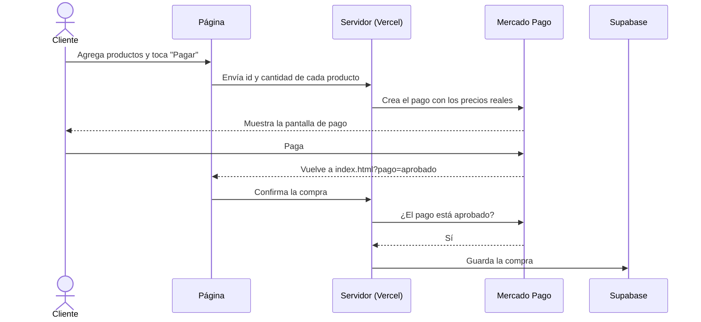

<div align="center">

# 🖨️ Print3d

### E-commerce de impresiones 3D

Proyecto integrador de la **Tecnicatura en Programación – UTN San Rafael**

<a href="https://print3dd.shop"></a>

<br><br>


<br><br>


</div>

---

## 📖 Sobre el proyecto

**Print3d** es una tienda real de impresiones 3D. Hicimos su página para que cualquier cliente pueda ver los productos, crearse una cuenta, armar su carrito y pagar online con Mercado Pago.

La página está publicada y funcionando en **[print3dd.shop](https://print3dd.shop)**.

## ✨ Funcionalidades

| | Funcionalidad | Descripción |
| :---: | --- | --- |
| 🛍️ | **Tienda con filtros** | Buscador sin importar tildes, filtro por categoría y material, y orden por precio o nombre |
| 🛒 | **Carrito de compras** | Agregar, cambiar cantidades y quitar productos. Se guarda en el navegador |
| 🔐 | **Registro e inicio de sesión** | Con nombre de usuario, email y contraseña, y email de confirmación personalizado |
| 💳 | **Pago con Mercado Pago** | Integración con Checkout Pro. Para pagar hay que iniciar sesión |
| 📦 | **Mis compras** | Cada usuario ve las compras que pagó, con fecha, productos y total |
| 📱 | **Responsive** | Se adapta a compu, tablet y celular, con menú hamburguesa |

## 🧰 Tecnologías

| Tecnología | Uso en el proyecto |
| --- | --- |
|  **HTML** | Estructura de las 8 páginas |
|  **CSS** | Estilos y diseño responsive, sin frameworks |
|  **JavaScript** | Filtros, carrito, sesión y comunicación con el servidor |
|  **Supabase** | Registro, login y base de datos PostgreSQL |
|  **Mercado Pago** | Cobros con Checkout Pro |
|  **Vercel** | Publicación de la página y funciones del servidor (`api/`) |
|  **Resend** | Envío de emails desde nuestro dominio |
|  **GitHub** | Control de versiones y trabajo en equipo |

## 🧪 Cómo probar la página

Mercado Pago está en **modo de prueba**: los pagos funcionan igual, pero **no se cobra dinero real**.

### 1. Crear una cuenta en la página

Entrá a **[print3dd.shop](https://print3dd.shop)**, tocá **Registrarse** y creá una cuenta con un email real. Te va a llegar un email para confirmarla.

### 2. Cuenta de prueba de Mercado Pago (comprador)

Al pagar, iniciá sesión en Mercado Pago con esta cuenta de prueba:

| Dato | Valor |
| --- | --- |
| Usuario | `TESTUSER6514301336241452251` |
| Contraseña | `izgvz5UIxh` |

> [!WARNING]
> No uses una cuenta real de Mercado Pago. Para que no se mezcle con una sesión abierta, conviene hacer la prueba en una **ventana de incógnito**.

### 3. Tarjetas de prueba

Elegí pagar con **Tarjeta** y usá esta:

| Tarjeta | Número | Código de seguridad | Vencimiento |
| --- | --- | --- | --- |
| American Express | `3711 803032 57522` | `1234` | `11/30` |

El resultado del pago depende del **nombre del titular** que pongas:

| Nombre del titular | Resultado |
| --- | --- |
| `APRO` | ✅ Pago aprobado |

En **DNI** debes poner `12345678`.

### 4. Ver la compra

Cuando el pago se aprueba, la página vuelve al inicio con el aviso **"¡Gracias por tu compra!"** y el carrito queda vacío. La compra aparece en **Mis compras**.

> [!TIP]
> Las tarjetas de prueba están en la [documentación de Mercado Pago](https://www.mercadopago.com.ar/developers/es/docs/checkout-pro/additional-content/your-integrations/test/cards), por si alguna cambia.

## 📁 Estructura del proyecto

```
📦 print3d
├── 📂 api                       → Funciones del servidor (Vercel)
│   ├── crear-preferencia.js     → Crea el pago en Mercado Pago con los precios reales
│   ├── confirmar-pago.js        → Guarda la compra cuando el cliente vuelve de pagar
│   └── webhook-mp.js            → Recibe los avisos de Mercado Pago
├── 📂 lib
│   └── supabase-servidor.js     → Funciones compartidas por las APIs
├── 📂 css
│   ├── general.css              → Estilos comunes: header, footer, botones, productos
│   └── *.css                    → Un archivo por página
├── 📂 js
│   ├── menu.js                  → Menú hamburguesa
│   ├── supabase.js              → Conexión con Supabase
│   ├── sesion.js                → "Hola, usuario" y cierre de sesión
│   ├── carrito.js               → Agregar productos y contador del carrito
│   ├── carrito-pagina.js        → Página del carrito y botón de pago
│   ├── tienda.js                → Filtros de la tienda
│   ├── login.js                 → Inicio de sesión
│   ├── registro.js              → Registro de usuarios
│   ├── pago.js                  → Avisos al volver de Mercado Pago
│   └── mis-compras.js           → Lista de compras del usuario
├── 📂 images                    → Imágenes de la página
├── index.html                   → Inicio
├── tienda.html                  → Catálogo de productos
├── nosotros.html                → Sobre la tienda y el equipo
├── contacto.html                → Datos de contacto y mapa
├── carrito.html                 → Carrito de compras
├── login.html                   → Iniciar sesión
├── registro.html                → Crear cuenta
└── mis-compras.html             → Compras del usuario
```

## 🔄 Cómo funciona una compra



1. El carrito se guarda en el `localStorage` del navegador.
2. Al pagar, la página manda al servidor **solo el id y la cantidad** de cada producto.
3. El servidor pone los **precios reales** y crea el pago. Así nadie puede cambiar un precio desde el navegador.
4. Cuando el cliente vuelve, el servidor **verifica con Mercado Pago** que el pago esté aprobado y recién ahí lo guarda.
5. Si el cliente cierra la página antes de volver, el **webhook** guarda la compra igual. Como el número de pago es único, nunca se guarda dos veces.

## 🗄️ Base de datos

La tabla `compras` se crea en Supabase desde el **SQL Editor**:

```sql
create table compras (
    id bigint generated always as identity primary key,
    user_id uuid not null references auth.users (id) on delete cascade,
    payment_id text not null unique,
    estado text not null,
    total numeric not null,
    productos jsonb not null,
    created_at timestamptz not null default now()
);

-- cada usuario solo puede ver sus propias compras
alter table compras enable row level security;

create policy "Cada usuario ve sus compras"
on compras
for select
to authenticated
using (auth.uid() = user_id);
```

> [!NOTA]
> Los usuarios los maneja Supabase en su tabla `auth.users`. El nombre de usuario se guarda en `user_metadata`.

## 🔑 Variables de entorno

Las claves secretas **no están en el código**: se cargan en Vercel, en **Settings → Environment Variables**.

| Variable | Descripción |
| --- | --- |
| `MP_ACCESS_TOKEN` | Access Token de Mercado Pago |
| `SUPABASE_URL` | URL del proyecto de Supabase |
| `SUPABASE_SECRET_KEY` | Clave secreta de Supabase (solo para el servidor) |
| `SITIO_URL` | *Opcional.* Dirección a la que vuelve el cliente después de pagar |

> [!TIP]
> En `js/supabase.js` va solo la **clave pública** de Supabase. Se puede mostrar sin problema porque los datos están protegidos por las reglas de seguridad (RLS).

## 🚀 Cómo publicarlo

1. Crear el proyecto en **Supabase** y correr el SQL de la tabla `compras`.
2. Completar `js/supabase.js` con la URL y la clave pública.
3. Importar este repositorio en **Vercel**, sin cambiar ninguna configuración.
4. Cargar las variables de entorno y hacer **Redeploy**.
5. En Supabase, en **Authentication → URL Configuration**, agregar el dominio de la página.

> [!IMPORTANTE]
> Mercado Pago está en **modo de prueba**. Para probar un pago se usa una cuenta de prueba compradora y una tarjeta de prueba con titular `APRO`. Para cobrar de verdad solo hay que cambiar `MP_ACCESS_TOKEN` por el token de producción.

> [!WARNING]
> El pago solo funciona con la página publicada en Vercel, porque la carpeta `api/` necesita el servidor. Abriendo los HTML desde la compu, el carrito funciona pero el botón de pagar no.

## 👥 Equipo

<div align="center">

### Masters of Code
*Tecnicatura en Programación – UTN San Rafael*

| Integrante | Parte del proyecto |
| --- | --- |
| **Francisco Knap** | Base del sitio, inicio, conexión con Supabase, carrito e integración con Mercado Pago |
| **Rafael Pacheco** | Tienda y filtros |
| **Ximena Tapia** | Páginas de nosotros y contacto |
| **Franco Cala** | Registro e inicio de sesión |
| **José Britos** | Sección Mis compras |

<br>

Hecho con 🧡 en Mendoza

</div>